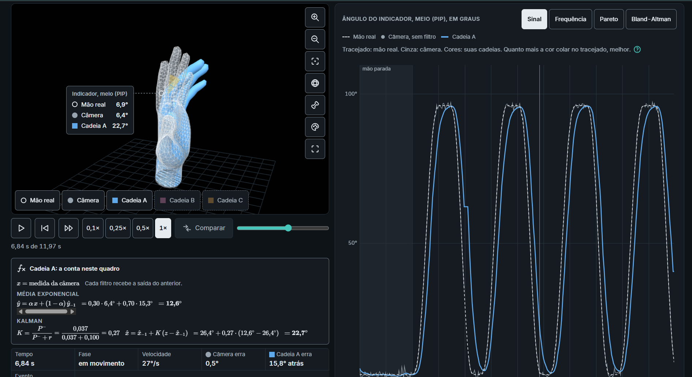

# Hand Filter Lab

**Laboratório interativo, no navegador, para entender e comparar filtros de suavização aplicados à medição dos ângulos da mão feita por câmera.**

**[Abrir o Hand Filter Lab](https://fidelis-leandro.github.io/hand-filter-lab/)**: roda direto no navegador, sem instalar nada.

> *Interactive browser lab to explore and compare smoothing filters (EMA, Median, Kalman, constant-velocity Kalman, One Euro, UKF, Butterworth) for camera-based hand joint angle estimation. UI in Portuguese.*



---

## O problema

Uma câmera comum detecta 21 pontos da mão e, a partir deles, calcula quanto cada articulação dobra. Essa detecção erra um pouco o tempo todo: aparecem tremor no sinal, pontos que saltam e quadros em que a mão é perdida. Para usar essas medidas em reabilitação, é preciso filtrar o sinal. Só que todo filtro troca estabilidade por atraso.

O Hand Filter Lab mostra esse problema de forma visual e deixa testar as soluções.

## O que dá para fazer

- **Aula guiada em 8 etapas:** do ruído da câmera até a combinação de filtros, passando por suavização, atraso, filtros adaptativos, *outliers* e Kalman.
- **Laboratório livre:** monte até **três cadeias de filtros** lado a lado, ajuste os problemas simulados da câmera (ruído, saltos, perdas) e compare **20 medidas** articulares.
- **Câmera ao vivo:** meça a própria mão com a câmera do aparelho, grave a sessão e aplique os filtros sobre os dados gravados.
- **Conferência do goniômetro:** mãos com ângulos conhecidos, para checar se o cálculo acerta cada articulação.
- **6 exercícios práticos:** por exemplo, remover um tremor de 6 Hz, conter saltos de pontos e fazer o One Euro responder a um degrau sem ultrapassar o valor final.
- **Modelo 3D da mão** que sobrepõe a mão real, a medida da câmera e cada cadeia de filtros.
- **Quatro visões de análise:** sinal no tempo, frequência, Pareto (compromisso entre erro e atraso) e Bland-Altman (concordância com o valor real).
- **A conta passo a passo:** em cada quadro, o laboratório mostra a fórmula de cada filtro da cadeia com os números daquele instante.
- **Reprodução controlada:** reproduza em 0,1×, 0,25×, 0,5× ou 1× e compare as cadeias no mesmo instante.

## Filtros disponíveis

São sete filtros, que podem ser combinados em cadeia:

| Filtro | Como funciona |
|---|---|
| **Média exponencial (EMA)** | Mistura a medida nova com a saída anterior, com peso α. |
| **Mediana** | Usa o valor do meio das últimas medidas (janela de 3 a 15) e ignora saltos isolados. |
| **Kalman** | Acompanha só o ângulo, ponderando a previsão e a medida da câmera. |
| **Kalman de velocidade** | Acompanha o ângulo e a velocidade, com a aceleração tratada como ruído (intensidade q). Prevê para onde o dedo vai e atrasa menos em movimentos rápidos. |
| **One Euro** | Média exponencial cuja suavização diminui quando o dedo se move rápido. |
| **UKF** | Kalman não linear (*Unscented*), com previsão e limite de velocidade angular. |
| **Butterworth** | Passa-baixa de segunda ordem, com frequência de corte em Hz. |

## Medidas

Flexão das articulações MCP, PIP e DIP e a soma total (TAM) de cada dedo, abdução dos dedos, medidas do polegar (MCP, IP, abdução radial e palmar, oposição), distância polpa-palma e abertura da pinça.

Movimentos simulados: flexão dos dedos, oposição polegar-mínimo, pinça polegar-indicador, abertura em leque e degrau (teste de resposta do filtro).

## Contexto

Este laboratório faz parte de uma pesquisa em Informática Biomédica (UFCSPA) sobre avaliação cinemática da mão por visão computacional na reabilitação após AVE. O sistema principal está em [computer-vision-based-hand-kinematic-assessment](https://github.com/Fidelis-Leandro/computer-vision-based-hand-kinematic-assessment).

No laboratório, a mão, o ruído e os filtros são simulados. O goniômetro e os filtros seguem a implementação usada no estudo.

> Ferramenta educacional e de pesquisa. Não é um dispositivo médico.

## Tecnologias

- HTML, CSS e JavaScript puro, em um único arquivo e sem etapa de build
- [Three.js](https://threejs.org/) r128 (MIT) para o visor 3D
- [MediaPipe Hand Landmarker](https://ai.google.dev/edge/mediapipe/solutions/vision/hand_landmarker) (Google, Apache 2.0) para a câmera ao vivo
- [KaTeX](https://katex.org/) (MIT) para as fórmulas
- Hospedado no GitHub Pages

## Como rodar localmente

```bash
git clone https://github.com/Fidelis-Leandro/hand-filter-lab.git
cd hand-filter-lab
python -m http.server 8000
```

Abra `http://localhost:8000` no navegador. A câmera ao vivo precisa de `localhost` ou HTTPS.

## Créditos

- Modelo 3D da mão: [WebXR Input Profiles](https://github.com/immersive-web/webxr-input-profiles), © 2019 Amazon, licença MIT
- Ícones: Tabler Icons (MIT, Paweł Kuna)
- Fonte: Inter (SIL Open Font License 1.1)

## Autor

**Leandro Fidelis**, estudante de Informática Biomédica na UFCSPA
[LinkedIn](https://www.linkedin.com/in/fidelisl)
